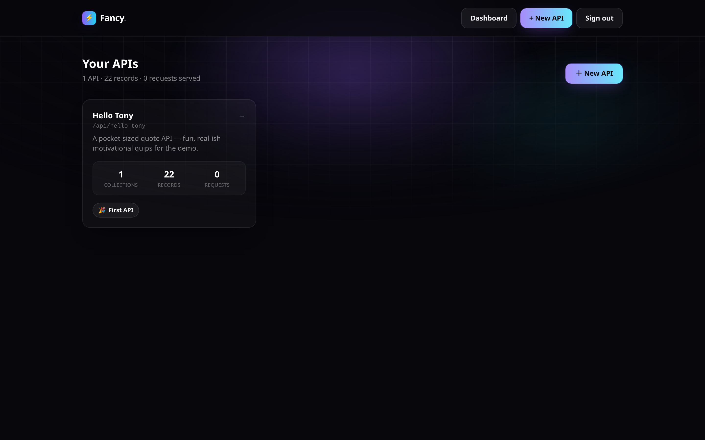
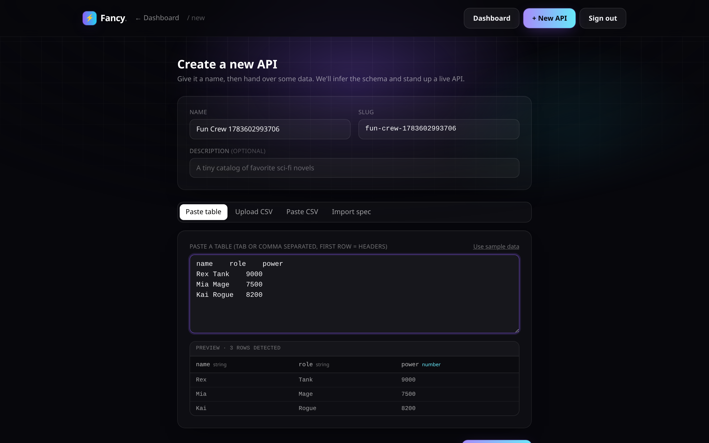
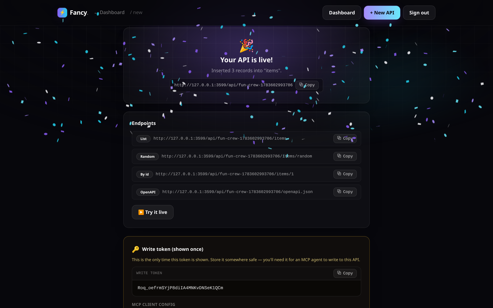
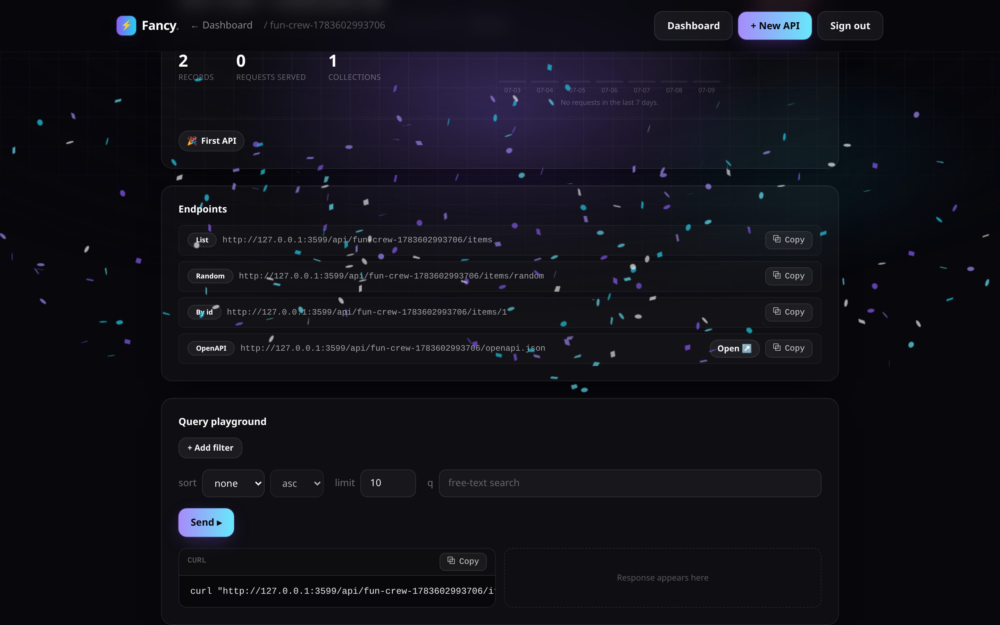

# Fancy

**Paste data. Get a fancy API.**

Fancy turns a table you paste, a CSV you drop, or a declarative YAML/JSON
file into a live, queryable REST API in minutes — filtering, sorting,
pagination, and full-text search included, with an OpenAPI doc generated for
free. It started from a simple problem: an app with nowhere to store its
data shouldn't need a backend project to get one. Every API also gets an
[MCP](https://modelcontextprotocol.io) endpoint, so an AI agent can read and
write records the same way a person edits a spreadsheet — no custom
integration code required. Self-hostable with one `docker compose up`.

[](LICENSE)


Repo: [github.com/carmelosantana/fancy-api](https://github.com/carmelosantana/fancy-api)

---

## Screenshots

**Dashboard** — your APIs, at a glance.


**Create an API** — paste a table, get a schema.


**Instant success** — live endpoints, a write token, ready to use.


**Query playground** — build a filtered request and see the response.


## Install

### Docker (recommended)

```bash
cp .env.example .env
make up
```

Open [http://localhost:3000](http://localhost:3000) and log in with the
`ADMIN_PASSWORD` from your `.env` (defaults to `change-me` — change it before
exposing this beyond your own machine).

The container seeds a demo API, `hello-tony`, on first start. Try it:

```bash
curl http://localhost:3000/api/hello-tony/quotes/random
```

```bash
make logs   # follow the web service
make down   # stop the stack (data persists in the fancy-data volume)
```

### Local dev

```bash
make install   # pnpm install
make seed      # populate the hello-tony demo against ./data/app.db
make dev       # next dev on http://localhost:3000
```

### Deploying somewhere else

Running Dokploy or Coolify (or anything Docker-based)? See
[Deploy on Dokploy / Coolify](#deploy-on-dokploy--coolify) below.

## The four ways to create an API

From `/admin/new`, pick one:

1. **Paste table** — paste tab- or comma-separated rows (e.g. straight out
   of a spreadsheet); Fancy infers column names and types.
2. **Upload CSV** — drop a `.csv` file.
3. **Paste CSV** — paste raw CSV text.
4. **Import declarative file** — paste a YAML or JSON spec that fully
   describes the api, its collection(s), and their schema + records.

A minimal declarative file looks like this:

```yaml
slug: hello-tony
name: Hello Tony Quotes
collections:
  - slug: quotes
    name: Quotes
    schema:
      - { name: author, type: string }
      - { name: text, type: string }
      - { name: year, type: number }
      - { name: topic, type: string }
    records:
      - author: Winston Churchill
        text: "Success is not final, failure is not fatal: it is the courage to continue that counts."
        year: 1941
        topic: perseverance
```

`schema[].type` is one of `string`, `number`, `boolean`, `date`. Any api can
be exported back to this same shape from its detail page — the declarative
file is a portable import/export format, not the runtime store (see
[Architecture](#architecture)).

## Query syntax

Every collection gets a read API at `/api/{api}/{collection}`, plus
`/{id}`, `/random`, and an OpenAPI document at `/api/{api}/openapi.json`.
Responses are shaped `{ data, meta: { total, limit, offset } }` (a single
object, no `meta`, for `/{id}` and `/random`).

| Syntax | Meaning |
|---|---|
| `field=value` | Equals |
| `field_gt=value` / `field_gte=value` | Greater than / or equal |
| `field_lt=value` / `field_lte=value` | Less than / or equal |
| `field_ne=value` | Not equal |
| `field_contains=value` | Substring match |
| `field_in=a,b,c` | In a set |
| `sort=field,-other` | Sort ascending by `field`, then descending by `other` |
| `limit=n` | Page size (default `25`, max `100`) |
| `offset=n` | Page offset |
| `q=text` | Free-text search across the collection's string columns |

Examples against the seeded `hello-tony` demo:

```bash
# List, filtered and sorted
curl "http://localhost:3000/api/hello-tony/quotes?topic=perseverance&sort=-year"

# Pagination
curl "http://localhost:3000/api/hello-tony/quotes?limit=5&offset=10"

# Free-text search
curl "http://localhost:3000/api/hello-tony/quotes?q=courage"

# One random record — handy for a "quote of the day" widget
curl "http://localhost:3000/api/hello-tony/quotes/random"

# A single record by id
curl "http://localhost:3000/api/hello-tony/quotes/1"

# OpenAPI document for the whole api
curl "http://localhost:3000/api/hello-tony/openapi.json"
```

## Writing data with AI agents (MCP)

Every api gets a write-capable [MCP](https://modelcontextprotocol.io)
endpoint at `/api/mcp/{api}`, served over Streamable HTTP. Read-only tools
work without a token; the four mutating tools require the api's write token,
sent as `Authorization: Bearer <writeToken>`. The token is shown once when
the api is created and can be rotated from its detail page in `/admin` at
any time.

```json
{
  "mcpServers": {
    "hello-tony": {
      "url": "http://localhost:3000/api/mcp/hello-tony",
      "headers": {
        "Authorization": "Bearer <writeToken>"
      }
    }
  }
}
```

Tools exposed:

| Tool | Requires token | Description |
|---|---|---|
| `list_records` | No | Paginated list of a collection's records |
| `get_record` | No | Fetch one record by id |
| `query_records` | No | Filter, sort, and free-text search |
| `insert_record` | Yes | Insert a single record |
| `insert_records` | Yes | Insert multiple records at once |
| `update_record` | Yes | Shallow-merge a patch into a record by id |
| `delete_record` | Yes | Delete a record by id |

## Self-hosting

- **Persistence** — the sqlite database lives at `DATABASE_PATH` inside the
  container (default `/data/app.db`), backed by the named `fancy-data`
  Docker volume. `make down` stops the stack without touching it; `make
  clean` deletes it (with a confirmation prompt).
- **Admin password** — set `ADMIN_PASSWORD` in `.env` before first start.
  Fancy has a single admin credential, no multi-user accounts (v1).
- **Ports** — the container listens on `3000`; the compose file maps it to
  `3000` on the host. Change the left side of the `ports:` mapping in
  `docker-compose.yml` to use a different host port.
- **Seeding** — `SEED_ON_START=1` (the default) seeds the `hello-tony` demo
  on every start; it's idempotent, so this is safe to leave on. Set it to
  `0` for a blank instance.

## Deploy on Dokploy / Coolify

Fancy is a single Docker container plus one sqlite file, which maps cleanly
onto either platform. Two supported paths:

### Option A — Dockerfile app (recommended)

Point the platform at this repo (or a fork) and let it build `Dockerfile`
directly — no compose file needed.

1. **App type**: "Dockerfile" / "Application from Git", build context = repo
   root, dockerfile path = `Dockerfile`.
2. **Port**: the container listens on `3000` — tell the platform to route to
   that port.
3. **Volume — required**: attach a persistent volume mounted at **`/data`**.
   The sqlite database lives at `/data/app.db`; without a persistent mount
   at that path, every redeploy starts from an empty database. This is the
   single most important setting for either platform.
4. **Environment**: set the variables from the table below.
5. **Domain**: add a domain and enable HTTPS (see the HTTPS note below).

### Option B — Docker Compose

Point the platform at `docker-compose.yml` and let it deploy the `web`
service as-is.

1. Set the same environment variables (below) on the `web` service.
2. Map your domain to service `web`, container port `3000`.
3. The `ports:` mapping in `docker-compose.yml` (`${WEB_PORT:-3000}:3000`)
   is there for local `docker compose up` convenience — on a PaaS the
   platform's reverse proxy talks to the container directly over its
   internal network, so publishing a host port is usually unnecessary and
   can conflict with other stacks. The domain/proxy feature is what
   actually exposes the app publicly; the `fancy-data` named volume still
   provides the persistent `/data` mount either way.

### Required environment

| Variable | Required | Notes |
|---|---|---|
| `ADMIN_PASSWORD` | Yes | The single admin login for `/admin` and the management API. |
| `SESSION_SECRET` | **Yes, for anything beyond a demo** | HMAC key signing the admin session cookie. Without it the app generates a random secret per process, so **every redeploy logs everyone out**. Generate one with: `node -e "console.log(require('crypto').randomBytes(32).toString('hex'))"` |
| `SEED_ON_START` | No | `1` (default) seeds the `hello-tony` demo API on start, idempotently. Set `0` for a blank instance. |
| `DATABASE_PATH` | No | Defaults to `/data/app.db`. Only change this if you also change where the persistent volume is mounted — it must always point inside that volume. |

### HTTPS note

Session cookies are marked `Secure` in production, so the app must be served
over HTTPS — the browser will silently drop the cookie otherwise and login
won't persist. Both Dokploy and Coolify default to a Traefik + Let's Encrypt
domain setup that handles this for you; if you instead hit the app over
plain HTTP by bare IP, expect to be logged out on every navigation.

### Scaling note

Fancy's storage is a single sqlite file (via libsql), not a networked
database — run **one instance only**. Multiple replicas pointed at the same
`/data` volume will corrupt or race on writes.

## Architecture

Monorepo, two packages:

- **`packages/core`** — the engine: ingest (CSV/paste/declarative-file
  parsing + type inference), the generic JSON-column record store, the
  query builder, the declarative import/export spec, and the MCP tool
  definitions. Framework-agnostic and meant to be reusable outside this
  Next.js app.
- **`apps/web`** — the Next.js (App Router) binding: the admin builder UI,
  the public read API, the management API, and the MCP HTTP route.

**Storage today is SQLite** (via `drizzle-orm/libsql` + `@libsql/client`) —
the query layer is built directly on SQLite's `json_extract`. **Postgres is
a roadmap item**, not a working option yet (see `docker-compose.yml`'s
commented-out `db` service and the design spec below); switching backends
will need query-layer changes, not just a connection string.

The declarative file (YAML/JSON) is a **portable import/export** format for
moving an api's shape + data in and out of Fancy. The database is the
runtime source of truth — the file is a snapshot, not something Fancy reads
from at request time.

## Development

| Target | Does |
|---|---|
| `make install` | `pnpm install` |
| `make dev` | Seed the local DB, then run `next dev` |
| `make build` | Production build (`next build`) |
| `make test` | Unit tests (Vitest) |
| `make e2e` | Playwright end-to-end suite |
| `make seed` | Populate the `hello-tony` demo against the local DB |
| `make typecheck` | Typecheck every workspace package |
| `make up` | Build (if needed) and start the Docker stack |
| `make down` | Stop the stack (keeps data) |
| `make logs` | Follow the web service's logs |
| `make restart` | Restart the web service |
| `make clean` | Stop the stack and delete the data volume (confirms first) |
| `make nuke` | `clean`, plus prune this project's build caches/images |

Run `make` (or `make help`) to print this from the terminal.

## Testing

- **Unit** (`make test` / `pnpm test`) — 99 Vitest tests over
  `packages/core` and `apps/web`: ingest/type-inference, the query builder,
  the record repo, spec import/export, auth token handling, and the MCP
  tool definitions.
- **End-to-end** (`make e2e` / `pnpm e2e`) — 8 Playwright specs driving the
  real app: creating an api from a pasted table, the query playground, MCP
  round-trips, and more.

## License

[AGPL-3.0](LICENSE). If you run a modified version of Fancy as a network
service, the AGPL requires you to make your modified source available to
users of that service.

## Design spec

The full design spec — goals, decisions, and the v1/roadmap split — lives at
[`docs/superpowers/specs/2026-07-08-declarative-api-platform-design.md`](docs/superpowers/specs/2026-07-08-declarative-api-platform-design.md).
